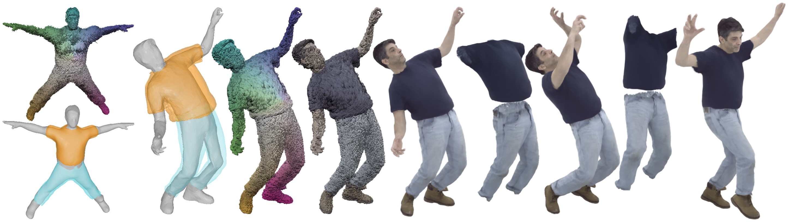

# CS5787 Project: D3GA on AIST++

This fork adds a small, reproducible AIST++ workflow to
[D3GA](https://github.com/facebookresearch/D3GA). It is designed for an NVIDIA
Blackwell GPU under VS Code + WSL and trains a pose-driven Gaussian avatar from
nine synchronized views of one AIST++ dancer.

Our quick experiment uses 120 sampled poses from
`gBR_sBM_cAll_d04_mBR0_ch01`: 100 poses for training and 20 held out for
evaluation. The lightweight configuration uses one whole-body cage and 5,000
Gaussians. In addition to replaying held-out motion, the trained avatar can be
driven by a new SMPL motion; `render_custom_wave.py` includes a procedural
raise-hand-and-wave example.

> **Data is not included.** AIST Dance DB videos prohibit unauthorized
> redistribution, and the SMPL model must be downloaded by each user after
> accepting its license. Do not commit videos, extracted frames, SMPL model
> files, checkpoints, or generated assets.

## What this fork adds

- An AIST++ dataset adapter with calibrated nine-camera support.
- Frame extraction and automatic person masks.
- A body-only D3GA configuration for short experiments.
- CUDA 12.8 / Blackwell (`sm_120`) installation support.
- Held-out pose evaluation and MP4 generation.
- A procedural novel-motion renderer.
- Compatibility fixes for plain SMPL, OpenCV 5, CMake 4, and WSL builds.

## 1. Environment

Clone with submodules, install
[Miniforge](https://github.com/conda-forge/miniforge), and create the environment:

```bash
git clone --recursive <THIS_REPOSITORY_URL>
cd cs5787-project
git submodule update --init --recursive

conda create -n d3ga python=3.10 -y
conda activate d3ga
./install_blackwell.sh
```

`install_blackwell.sh` targets RTX 50-series/Blackwell GPUs. It installs
PyTorch 2.7.1 + CUDA 12.8 and builds the local CUDA extensions serially to
avoid WSL memory spikes. The first installation can take a while because
PyTorch3D is compiled from source.

Confirm that WSL can see the GPU before training:

```bash
nvidia-smi
python -c "import torch; print(torch.cuda.get_device_name(0), torch.cuda.is_available())"
```

## 2. Licensed data and expected layout

Read the official [AIST Dance DB terms](https://aistdancedb.ongaaccel.jp/terms_of_use/).
If you agree, this command downloads only the exact nine 10 Mbps videos used by
our sequence, plus the AIST++ motion and camera annotation archives:

```bash
python scripts/download_aist_subset.py \
  --dataset-root ~/datasets/AIST++ \
  --sequence gBR_sBM_cAll_d04_mBR0_ch01 \
  --workers 3 \
  --agree-to-terms
```

Use `--dry-run` to print every official permalink without downloading. The
script checks the requested filenames against Google's official AIST++ video
list, resumes by skipping completed files, and extracts `motions.zip` and
`cameras.zip`. The URLs come from the official
[AIST++ downloader](https://github.com/google/aistplusplus_api/blob/main/downloader.py)
and [AIST++ release](https://google.github.io/aistplusplus_dataset/download.html);
the repository does not mirror any data.

The resulting files are stored outside the repository:

```text
~/datasets/AIST++/
├── videos/
│   ├── gBR_sBM_c01_d04_mBR0_ch01.mp4
│   ├── ...
│   └── gBR_sBM_c09_d04_mBR0_ch01.mp4
└── annotations/
    ├── cameras/
    │   ├── mapping.txt
    │   └── setting1.json
    └── motions/
        └── gBR_sBM_cAll_d04_mBR0_ch01.pkl
```

Register for and download the neutral SMPL v1.1 model from the
[official SMPL site](https://smpl.is.tue.mpg.de/). Convert the legacy
Chumpy-backed pickle locally:

```bash
python scripts/convert_smpl_pickle.py \
  /path/to/basicmodel_neutral_lbs_10_207_0_v1.1.0.pkl \
  ~/datasets/body_models/smpl/SMPL_NEUTRAL_NUMPY.pkl
```

The launch scripts default to `~/datasets/AIST++` and
`~/datasets/body_models/smpl/SMPL_NEUTRAL_NUMPY.pkl`. To use other locations,
set `AIST_ROOT` and `SMPL_MODEL` before running them:

```bash
export AIST_ROOT=/path/to/AIST++
export SMPL_MODEL=/path/to/SMPL_NEUTRAL_NUMPY.pkl
```

## 3. Prepare the 120-pose subset

The preparation script extracts 120 synchronized frames from each of nine
cameras at 960x540 and creates person masks with torchvision DeepLabV3:

```bash
python scripts/prepare_aist.py \
  --dataset-root ~/datasets/AIST++ \
  --sequence gBR_sBM_cAll_d04_mBR0_ch01 \
  --output ~/datasets/AIST++/prepared/gBR_sBM_cAll_d04_mBR0_ch01 \
  --num-frames 120 \
  --width 960 \
  --height 540 \
  --batch-size 2
```

This produces 1,080 images and masks. The first run downloads the pretrained
segmentation weights.

## 4. Train

For a short pipeline check, set `train.iterations: 500` in
`configs/aist_quick.yml`. For the experiment used here, use 5,000 iterations:

```bash
./scripts/train_aist_quick.sh
```

Training automatically resumes from the latest checkpoint in:

```text
experiments/aist_quick/gBR_sBM_cAll_d04_mBR0_ch01/body/checkpoints/
```

The first run also creates and tetrahedralizes the reusable body cage under
`runtime_assets/`. These generated directories are intentionally ignored by
Git.

## 5. Render held-out poses

Render the 20 poses excluded from training using checkpoint 5,000:

```bash
./scripts/render_aist_heldout.sh 5000
```

The evaluator writes ground truth, predictions, heatmaps, aggregate
SSIM/PSNR/LPIPS metrics, and an MP4 under `cinema_005000/` in the run directory.
Our 5,000-step run produced SSIM 0.9823, PSNR 28.16 dB, and LPIPS 0.01696; these
full-frame metrics are optimistic because most pixels are white background.

## 6. Drive the avatar with a new motion

Render a four-second motion that was procedurally created rather than taken
from the training video:

```bash
./scripts/render_custom_wave.sh
```

This generates a 120-frame, 30 fps animation in `novel_wave_005000/`. The
motion raises the right arm, waves three times, and lowers it. The generated
72-dimensional SMPL sequence is saved alongside the video as
`wave_motion.npz`.

The avatar can also be driven by other valid SMPL motion sources, but poses far
outside the training distribution may create appearance artifacts.

## 7. FSGS-style Gaussian unpooling (AIST++ cage experiment)

The AIST++ quick configuration includes an experimental, D3GA-compatible
implementation of **proximity-guided Gaussian unpooling**. It computes each
Gaussian's mean distance to its nearest neighbors in canonical space and
inserts new Gaussians between selected neighbors in locally sparse regions.
To preserve D3GA deformation, each new midpoint is assigned to a valid
cage tetrahedron and represented with barycentric coordinates. If neither
parent tetrahedron contains the midpoint, the implementation falls back to
the nearest tetrahedron and projects the barycentric weights onto its simplex.

Enable or disable the experiment in `configs/aist_quick.yml`:

```yaml
train:
  fsgs:
    enabled: true
    start_iteration: 1000
    interval: 1000
    knn_k: 4
    proximity_percentile: 90.0
    max_new_gaussians: 250
```

This is an **FSGS-inspired adaptation of its unpooling component**, not a full
reproduction of FSGS. Pseudo-view generation and monocular-depth guidance are
not included in this patch. The depth component should be coordinated with
the separate DNGaussian implementation in the project team.

The Gaussian count changes at the configured iterations. The trainer updates
the optimizer parameter references and Adam state, and checkpoint loading
resizes Gaussian-indexed tensors to match checkpoints saved after unpooling.
For a clean comparison, train a fresh baseline with `enabled: false` and an
FSGS run with `enabled: true`, keeping all other settings and camera subsets
identical.

For a metrics-only evaluation without generating the comparison video, run:

```bash
python evaluate.py configs/aist_quick.yml 5000
```

The optional iteration argument selects the checkpoint to evaluate. If omitted,
the script evaluates the latest checkpoint:

```bash
python evaluate.py configs/aist_quick.yml
```

## What to commit

Commit source code, configuration, scripts, and this documentation. Do not
commit:

- AIST videos, extracted frames, or masks;
- SMPL model files;
- trained checkpoints or rendered videos;
- `experiments/`, `runtime_assets/`, `outputs/`, build products, or caches.

The AIST++ annotations are CC BY 4.0, but this project still downloads them from
the official source instead of vendoring a large copy. The original videos are
subject to the separate AIST Dance DB terms.

---

## Upstream D3GA documentation

<h2 align="center"><b>D3GA - Drivable 3D Gaussian Avatars</b></h2>

<h4 align="center"><b>
    <a href="https://zielon.github.io/" target="_blank">Wojciech Zielonka</a><sup>1,2,3*</sup>, 
    <a href="https://scholar.google.ch/citations?user=oLi7xJ0AAAAJ&hl=en" target="_blank">Timur Bagautdinov</a><sup>3</sup>, 
    <a href="https://shunsukesaito.github.io/" target="_blank">Shunsuke Saito</a><sup>3</sup>, 
    <a href="https://zollhoefer.com/" target="_blank">Michael Zollhofer</a><sup>3</sup><br>
    <a href="https://justusthies.github.io/" target="_blank">Justus Thies</a><sup>1,2</sup>, 
    <a href="https://scholar.google.com/citations?user=Wx62iOsAAAAJ&hl=en" target="_blank">Javier Romero</a><sup>3</sup>
</b></h4>

<h6 align="center">
    <sup>1</sup><i>Max Planck Institute for Intelligent Systems, Tübingen, Germany</i><br>
    <sup>2</sup><i>Technical University of Darmstadt  </i>
    <sup>3</sup><i>Meta</i>
</h6>

<h4 align="center">
<a href="https://youtu.be/C4IT1gnkaF0" target="_blank">Video&nbsp</a>
<a href="https://arxiv.org/pdf/2311.08581.pdf" target="_blank">Paper&nbsp</a>
<a href="https://github.com/facebookresearch/goliath?tab=readme-ov-file#data" target="_blank">Dataset&nbsp</a>
<a href="https://zielon.github.io/d3ga/" target="_blank">Website&nbsp</a>
</h4>

<div align="center"> 

<i style="font-size: 1.05em;">Official Repository for D3GA - Drivable 3D Gaussian Avatars</i>
</div>
<br>

### Installation

Please follow these steps to install the repository and the required libraries: first, clone the repository along with its submodules; then, create the environment and install all necessary dependencies.

```
git clone --recursive https://github.com/facebookresearch/D3GA.git
cd D3GA
git submodule update --init --recursive
```

After the repository is recursively cloned with all the submodules, we can create the environment and install the libraries.

```
conda create -n d3ga python=3.9 -y
conda activate d3ga
./install.sh
```

### Datasets

We used two datasets, [ActorsHQ](https://github.com/synthesiaresearch/humanrf) and [Goliath](https://github.com/facebookresearch/goliath) (ClothedBody). Please follow official download instructions to obtain the training images. We provide dataloaders which support those two datasets.

### Additonal Assets

We use assets such as garment cages for **Goliath**, additional tracking, and segmentation masks for **ActorsHQ**, provided by Wojciech Zielonka (TU Darmstadt), available under [Goliath](https://drive.google.com/drive/folders/15Z7WMKPB3p1boaRgUkkgZ6i2Ig7iW6jI?usp=sharing) and [ActorsHQ](https://drive.google.com/drive/folders/1bVH0fh2CmwrD8_rozwGn8fNLi6dMFsrF?usp=sharing) links. In the configs you then specify for instance `assets: datasets/D3GA/actorshq/` or `assets: datasets/D3GA/goliath/`.

The **ActorsHQ** dataset contains **camera parameters, SMPL-X parameters, and segmentation masks**. To successfully train, one needs to provide images and alpha masks from the dataset.  

See the exemplary configuration file: `actorshq_actor02.yml`.

After downloading the corresponding assets for each actor in a given dataset (Goliath or ActorsHQ), please specify the paths in the configuration file.

The SMPL-X model can be found at the following link [SMPL_python_v.1.1.0](https://smpl-x.is.tue.mpg.de/download.php) (the first option). Please note that you need to create an account to access the models.

Afterward, set the following paths in the configuration file:

```
smplx_topology: ${smplx_dir}/SMPL_python_v.1.1.0/smplx/models/SMPLX_NEUTRAL.npz
smplx_model: ${smplx_dir}/SMPL_python_v.1.1.0/smplx/models/SMPLX_NEUTRAL.pkl
```

In the case of generating your own assets, such as cages for each garment piece, please follow the instructions below.

###  Training

Training is strightforward and requires only specifying confing for the `train.py`.

For instnace.
```
# Goliath Dataset
python train.py configs/goliath_axe184.yml

# ActorsHQ Dataset
python train.py configs/actorshq_actor02.yml 
```

To run default testing you can use `test.py`. It will generate the output frames and video.
```
python test.py configs/goliath_axe184.yml
python test.py configs/actorshq_actor02.yml 
```

### Cage generation

To generate cages for a new sequence we need to first create a mesh with segmentation. Meaning, we need to backproject segmentation maps onto the mesh faces such that for each face we have a corresponding segmentation label. `segmentation.py` script samples random images from the dataset and returns topology with color corresponding to the given label such that we can easily crop the mesh according to the label `(upper, lower, etc)`.

The cage generation (cropping the mesh according to the segmentation and generating tetrahedron) is fully automatic. However, most of the time it requires manual inspection and a MeshLab post-cleaning algorithm (unfortunately). The latter step is very important because in most of the cases the simplification algorithm after marching cubes creates self-intersection faces which will cause the tetrahedralization process to explode. Thus for each garment cage you need to:

#### First breakpoint

Open `mc_source.ply` from your output folder (it is specified in the config file as `assets`) in MeshLab see if the mesh is correct after cropping based on the segmentation mask. (You might need to close small holes or remove some outliers).

#### Second breakpoint

We need to remove all the self-intersecting faces using MashLab. Open `cage.ply` in MeshLab from the `assets` folder and use Taubin Smooth with default parameters. It will smooth the cage for the last time and remove all self-intersection faces as a post-cleaning step.

### License
D3GA is Attribution-NonCommercial 4.0 International licensed, as found in the LICENSE file.

### Citation
If you use this project in your research please cite D3GA:
```bibtex
@article{zielonka25dega,
  title        = {Drivable 3D Gaussian Avatars},
  author       = {Wojciech Zielonka and Timur Bagautdinov and Shunsuke Saito and 
                  Michael Zollhöfer and Justus Thies and Javier Romero},
  booktitle    = {International Conference on 3D Vision (3DV)},
  month        = {March},
  year         = {2025}
}
```

*Work done while Wojciech Zielonka was an intern at Codec Avatars Lab, Meta, Pittsburgh, PA, USA
